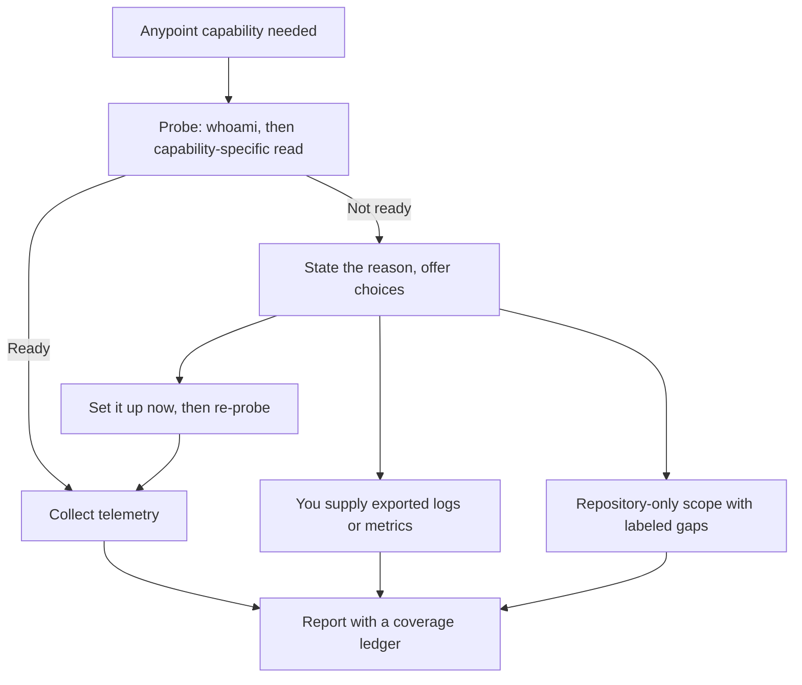

# Anypoint access

`anypoint-connect` is the only one of the three MCP servers that needs authentication. `mule-build`
and `mule-lint` work with no credentials.

Set this up for runtime evidence or requested design-platform work: Design Center, Exchange,
centralized API Governance, logs, metrics, deployments, API Manager, queues, or Object Store. Skip it
for local contract design/validation, documentation, development, lint, build, packaging, or static review.

## What happens when it is not set up

The skills do not fail silently and do not stall. `mule-api-design`, `mule-ops`,
`mule-troubleshooting` and `mule-review` probe the required capability before their first connector
call, then tell you which state they found and offer a choice.



Two consequences worth knowing:

- **Nothing blocks.** A review or a diagnosis still completes from repository evidence; the report
  names the coverage it could not reach.
- **Exports are second-class on purpose.** Logs and screenshots you paste in are labeled
  user-provided with the coverage you state. They can support a correlation, but absence of an entry
  in a truncated or filtered export never proves absence.

| Skill | With access | Without access |
| --- | --- | --- |
| `mule-api-design` | Design Center/Exchange/Governance reads and separately approved writes | Local design, authoring, and AMF validation continue normally |
| `mule-ops` | Full runtime health assessment | Repository and configuration review, or analysis of exports you supply |
| `mule-troubleshooting` | Telemetry-confirmed root cause | Source-based hypotheses with the discriminating checks named |
| `mule-review` | Optional runtime verification of a finding | Complete review with the runtime gap disclosed |

## Set it up

Run these yourself. An agent following these skills will print them rather than run them, because
they change machine-local state.

Use Node.js 22 or newer; Node.js 24 LTS is recommended. You also need an Anypoint Connected App
configured as **App acts on behalf of a user** with the **Authorization Code** grant, redirect URI
`http://localhost:3000/api/callback`, and the `full offline_access` scopes. If you cannot create the
app, send those exact settings to your Anypoint organization administrator. The
[anypoint-connect credential guide](https://avinava.github.io/anypoint-connect/credentials/) owns
the complete administrator handoff, storage, rotation, and troubleshooting instructions.

The Client ID and Secret identify the Connected App but do not grant platform access by themselves.
The user still authorizes access in a browser, and a new headless CI runner cannot authenticate with
only those two values.

```bash
npx -y @sfdxy/anypoint-connect@0.17.0 config init
npx -y @sfdxy/anypoint-connect@0.17.0 auth login
npx -y @sfdxy/anypoint-connect@0.17.0 auth status
```

A global install gives you the shorter `anc` command:

```bash
npm install -g @sfdxy/anypoint-connect@0.17.0
anc config init
anc auth login
anc auth status
```

Use the same pin the MCP configuration uses. A CLI on one version and an MCP server on another is a
confusing way to debug a login problem.

`config init` masks the Client Secret. Enter it at that prompt rather than placing it in a command,
project file, issue, or chat. `auth login` opens the browser-based authorization flow.

### Multiple organizations

Use a neutral local profile identifier rather than an organization or customer name:

```bash
anc config init --profile org-a
anc auth login --profile org-a
anc config use org-a
anc auth status
```

`anc config use` writes `.anypoint-connect.json` in the project. It binds a machine-local profile
rather than storing credentials, but it can reveal local organization labeling, so add it to
`.gitignore`:

```gitignore
.anypoint-connect.json
```

## Verify

Two things have to be true: the MCP server is configured in your host, and the CLI profile is
authenticated. Check them separately, because the fixes are different.

| Check | How | Fix if it fails |
| --- | --- | --- |
| Server configured | `/mcp` in Claude Code, `codex mcp list`, `copilot mcp list`, or your host's MCP view | Install path for your host: [Claude Code](install-claude-code.md), [other agents](install-other-agents.md) |
| Authenticated | `anc auth status` | `anc auth login` |
| Visible to the agent | Ask the agent to confirm Anypoint access | See the failure modes below |

Runtime readiness uses `whoami` and `list_environments`. Design readiness uses `whoami` and
`list_design_center_projects`; it does not require runtime environment visibility. The skills redact
identity and organization details from their report.

## Failure modes

| State | What you see | Fix |
| --- | --- | --- |
| Not configured | The host exposes no `anypoint-connect` tools at all | Add the MCP entry for your host, then restart or reload it. Login is not the problem |
| Not authenticated | Tools exist but report missing, invalid, or expired credentials | `anc auth login`, then re-check `anc auth status` |
| Environment not visible | Authentication works, but the environment you asked about is absent | Wrong organization or profile, a business-group boundary, or a misspelled environment name. Check `anc config use` and the environment list |
| Not permitted | Authentication and environment resolve, but an operation is refused | The identity or the subscription lacks that capability. Use an identity with the right scope, or supply an export instead |
| Transient failure | Timeout, rate limit, or server error | Retry once with a narrower window before treating it as an access problem |

A first `npx` start also downloads the package, so a cold start can look like a hang. Wait for it
once; later starts use the cache.

## Privacy

The skills already treat organization and identity detail as sensitive, and they will not put it in
a report. Keep the same boundary yourself:

- Do not commit `.anypoint-connect.json`.
- Do not paste tokens or credentials into a chat. The CLI holds the session; the agent never needs
  the secret itself.
- Redact identifiers, private hostnames, and payloads from logs you supply, or expect the skill to
  paraphrase and redact them in the output.
- Exported telemetry belongs outside the repository. Point the agent at a path; do not commit the
  file.

## Approval for mutating tools

Read-only tools (status, logs, metrics, audit, settings reads) are safe to pre-approve. Tools that
change a running app ask on every call by default: a property write is a full redeploy, and a deploy
call can keep running after the session ends. In Claude Code, list them under `ask` in the project's
`.claude/settings.json`:

```json
{
  "permissions": {
    "ask": [
      "mcp__anypoint-connect__deploy_app",
      "mcp__anypoint-connect__deploy_jar",
      "mcp__anypoint-connect__update_app",
      "mcp__anypoint-connect__update_app_artifact",
      "mcp__anypoint-connect__update_app_settings",
      "mcp__anypoint-connect__restart_app",
      "mcp__anypoint-connect__rollback_app",
      "mcp__anypoint-connect__scale_app",
      "mcp__anypoint-connect__start_app",
      "mcp__anypoint-connect__stop_app",
      "mcp__anypoint-connect__delete_app",
      "mcp__anypoint-connect__publish_app_jar",
      "mcp__anypoint-connect__smoke_test_api",
      "mcp__anypoint-connect__create_alert",
      "mcp__anypoint-connect__update_alert",
      "mcp__anypoint-connect__set_alert_enabled",
      "mcp__anypoint-connect__delete_alert"
    ]
  }
}
```

### Pre-approving when you choose to

You can skip the prompt for some or all of these tools, for example in a sandbox project where an
agent runs repeated deploys. Move the tools you want under `allow`, ideally in a project or local
settings file scoped to that workspace rather than in your global settings:

```json
{
  "permissions": {
    "allow": [
      "mcp__anypoint-connect__deploy_jar",
      "mcp__anypoint-connect__update_app",
      "mcp__anypoint-connect__restart_app"
    ]
  }
}
```

Pre-approval removes the host prompt only. The skills still preview each change, name the exact app
and environment before committing it, and anypoint-connect still requires its own explicit
confirmation for production and refuses artifacts marked not production-deployable. The skills never
suggest pre-approval or edit your permission settings; that choice is yours.

Other hosts have an equivalent per-tool approval or auto-approve setting; the same list applies.

### Pre-approving production

Production changes need a second confirmation on top of the host prompt: the agent asks you before
it sends `confirmProduction: true`, and the CLI asks you to type a confirmation. When a team wants
an agent or pipeline to change production without that second step, for example a scheduled
restart or an approved release window, pre-approve it with `set_production_preapproval`:

```text
Ask the agent: pre-approve production environment "<ENV>" for update_app and restart_app until
<DATE>.
```

The approval is stored in your user-level anypoint-connect configuration, never in the repository,
and is bound to the organization and environment IDs. Switching to another organization never
carries it over; switching profile or credentials within the same organization and environment does,
so clear it when the identity that should hold it changes. An approval written into a project's `.anypoint-connect.json` is ignored and
reported, so a branch cannot grant itself production access. Setting it is previewed and confirmed.
While it is active:

- previews show `productionPreapproved: true` and the agent states that it applied;
- the agent and CLI skip the second confirmation only for the listed environment and tools;
- previews, `confirm: true`, bound identifiers such as the expected digest or deployment id, and
  the production artifact checks still apply;
- an expired entry is ignored, and clearing it restores the default;
- `"all-mutating"` covers every mutating tool except `delete_app` and `delete_alert`, which must be
  named;
- `thisProjectOnly` limits it to one project directory.

### Artifacts without a build marker

Every production change that selects an artifact checks the build marker inside the jar it will
run, downloading it from Exchange when needed. Stripped or inconsistent markers are always refused.
A jar with no marker, from another build pipeline or from before mule-build 3.2, is refused for
production unless you allow it for that environment with `set_unmarked_artifact_allowance`
(user-level, organization and environment IDs, optional expiry). If your rollback target predates
the marker, set the allowance while planning the release rather than during an incident.

Combine these with host pre-approval (above) only when no human should see a prompt at all, and
scope everything to the workspace that needs it. See the
[anypoint-connect documentation](https://avinava.github.io/anypoint-connect/) for the exact fields.

## What the skills do with access

The readiness workflow the skills follow lives in the repository at
[`skills/mule-ops/references/anypoint-readiness.md`](https://github.com/Avinava/mule-skills/blob/main/skills/mule-ops/references/anypoint-readiness.md).
It defines the probe, the access states, the choices offered, the metadata required for supplied
exports, and the rule that an access state appears in the report whenever it limited scope.
